# bookworld journal

A running record of what was built, what broke, and what it looked like. Screenshots live in `docs/journal/`. Written for a future blog post or book about building the engine, so decisions and dead ends are kept, not just results.

## 17 Oct 2026, day one

**Morning: the brief.** Concept, plan, world file schema, 3D stack decision and the Ethora facts and gaps were written up before any code (commit `73ee5ef`). Decisions: 3D first, Three.js through React Three Fiber, Colyseus as the world service, Ethora untouched and used only through its public surface, the world file as the product.

**Afternoon: scaffold and the movement loop (commit `dcac1b4`).** pnpm workspaces (client, server, shared, worlds), gitleaks hook. The Alice world written by hand: Rabbit Hole, Hall of Doors, Garden, Tea Party in a line, the Hatter at the Tea Party. The Ethora App, four rooms and the Hatter agent were provisioned over the hosted MCP in a few minutes; chapter 7 of the book went in as the Hatter's knowledge and the first test reply quoted the Queen's concert.

Surprises while installing: pnpm 12 blocks git-hosted subdependencies (the `colyseus` meta package pulls uWebSockets.js from git, so `@colyseus/core` + `@colyseus/ws-transport` are used instead) and needs an `allowBuilds` list; Colyseus 0.18's browser package is `@colyseus/sdk`, not `colyseus.js`; ecctrl 2.0 reads input only through `setMovement` and has no first-person camera, so the camera is driven by drei's pointer-lock control and glued to the capsule each frame.

The box-room template got procedural wallpaper from a canvas (base colour, faint diamonds in the trim colour, grain) because no wallpaper images existed yet. Door detection is by position: standing inside a doorway on a wall with an exit sends `move`. The server validates, grants the next Ethora room, narrates "has left (E)", and the client leaves the Colyseus room and joins the next one at the opposite door.

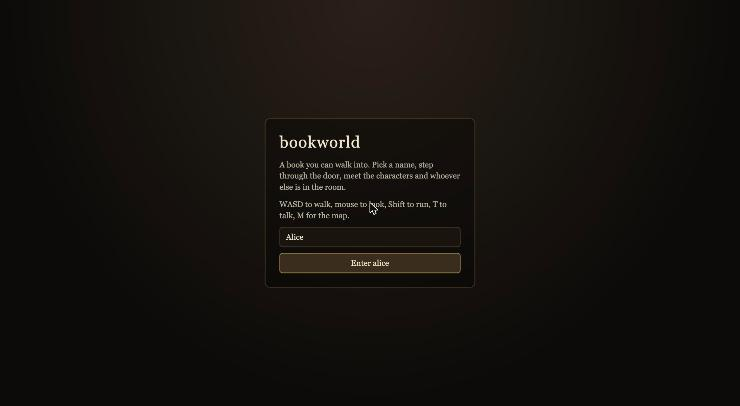
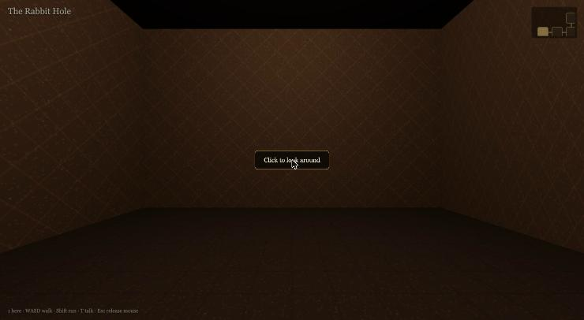

Verified with two browser tabs: both walked Rabbit Hole to Hall of Doors through the door, each saw the other as a capsule with a name label, "2 here" in the HUD, and the server log showed "Alice has left (E)" then "Alice has joined (W)".

**Evening: chat (commit `dd7ad58`).** With the App Secret in `.env`, guests get an Ethora identity through `@ethora/sdk-backend` and a client JWT for the chat component. Three things cost an hour: the SDK wants the API host root rather than `/v1`; the broadcast endpoint rejects a per-message sender name, so narration arrives under the app's name; and the chat panel sat on "Connecting..." until the XMPP endpoint was passed in `xmppSettings` and `initBeforeLoad` was turned off. Also learned that MCP-created rooms are public app chats, so every user is in all of them and the access grant endpoint cannot see them: "one room at a time" is enforced by the client pinning the panel, which is enough for a demo.

The first conversation from inside the 3D client: walk three rooms, press T, "@Hatter good evening", and the Hatter answered in about five seconds.

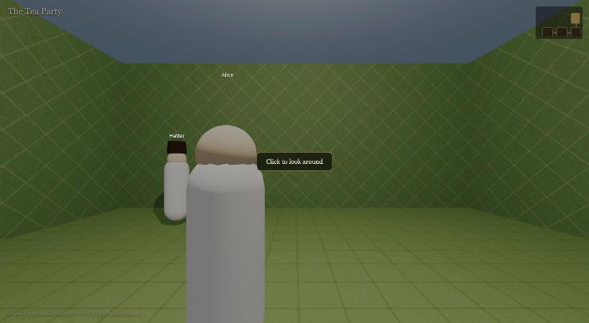

**Night: pointer lock, props, people (this entry).** Two bugs the owner noticed on first play had one cause: every door walk rebuilt the whole WebGL canvas. Now one canvas lives for the whole visit and only the room contents swap (commit `8a80911`). A second effect, the scene scrolled 393 px sideways, came from the hidden chat panel being slid outside its container: the browser scrolled to it when the chat input took focus.

Then props and characters. CC0 kits only: Kenney's furniture and food kits (glTF, tiny files, vertex colours) and the KayKit Adventurers pack (five rigged low-poly characters with Idle, Walking and Running clips baked in). No Mixamo, which needs an Adobe login, and no VRM for now; the loader can take VRM later. A props catalog maps ids like `teacup` or `bookcase` to kit files and scales; the world file places them by id. The Hall of Doors got its row of locked doors and the glass table with a bottle on it, the Tea Party its long table, chairs, cups, cake and a honey jar; the Hatter wears the Mage's purple hat.

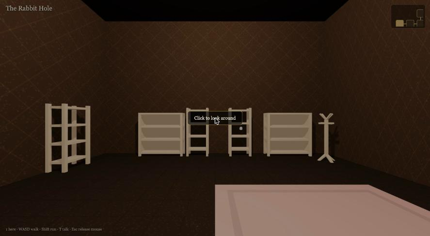
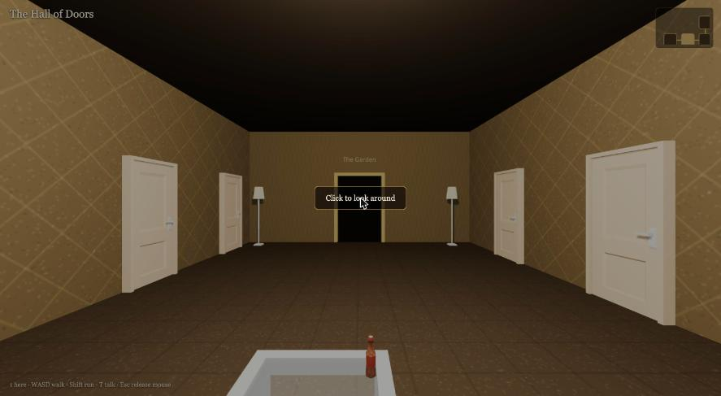
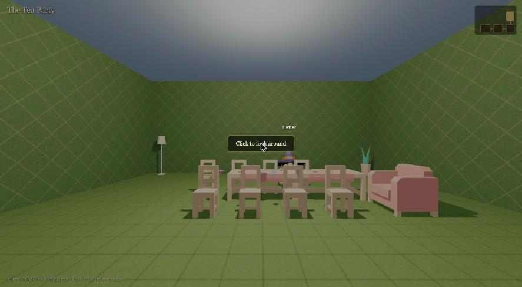

The small Hatter: the glb's mesh bounds say 3.3 units tall, but the character is modelled at about 1.75 m, so the first scale guess made him knee-high. Fixed to scale 1.

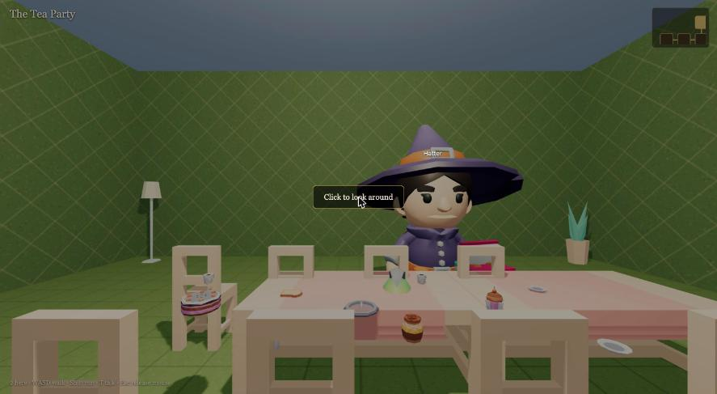

Speech bubbles: the chat component's `CustomScrollableArea` prop hands over the room's messages, so new lines from other people float above their avatar for eight seconds. Narration lines render as quiet italic system text in the panel. Verified with a second player (Bob, on a second origin so the browser sessions stay apart): his line appeared over his head in Alice's view.

Two things to remember: after a Vite hot reload the physics world and the animation mixer can be left stale (the Hatter stood in a T-pose once), so test after a full reload; and the Hatter's bot instance went silent after about twenty minutes while the agent itself still answers in a direct test (ETHORA-GAPS #13).

## 17 Oct 2026, late evening: Phase 1 items 3 to 6

**Rooms that look like places.** The owner picked panorama rooms, wallpaper images, music and character life from the Phase 1 list. With no image generator in the loop, the sources are Poly Haven (CC0 HDRIs and PBR textures with a public API and direct file links) and Kevin MacLeod's CC BY music. The Garden is now a panorama room: a 2k HDRI of the Borghese gardens as sky and light, a grass floor three rooms wide so the horizon meets the picture, invisible walls, free-standing door frames. The closed rooms got real textures: planks and leaf litter in the well, patterned plaster and a checkered floor in the Hall, a leafy hedge and grass at the Tea Party. The Poly Haven tonemapped JPGs are 50 MB each, so the 2k `.hdr` (7 MB) goes straight into drei's `Environment`.

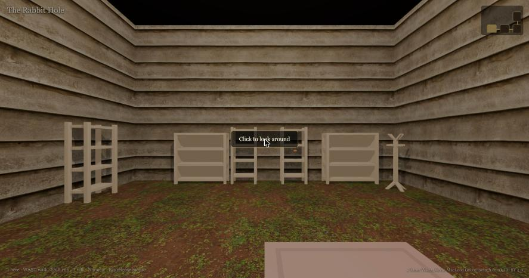
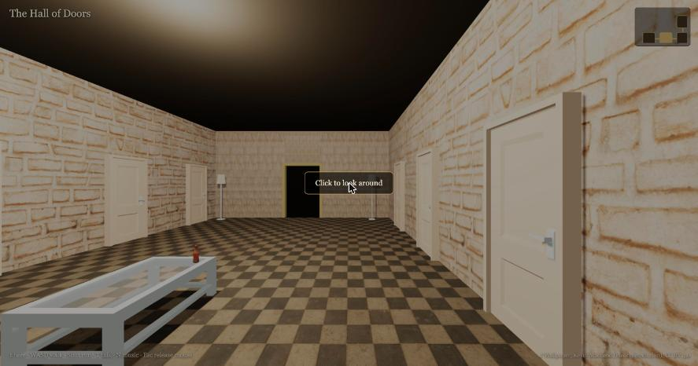
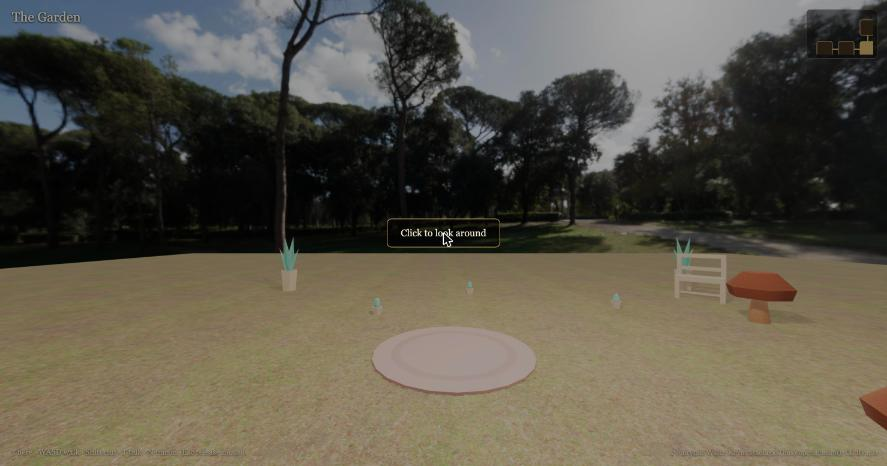
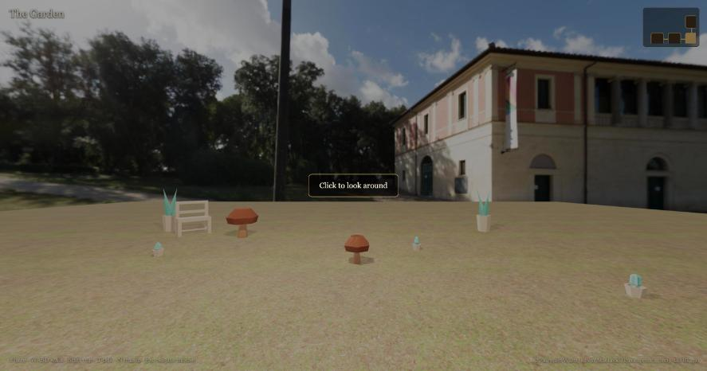

**Music.** One looping track per room from the world file, with title and credit in the HUD, N to mute. Browsers refuse autoplay, so the track starts on the first click (the same click that captures the mouse) and crossfades on room change. The MP3s were 3 to 9 MB each; `afconvert` on the Mac re-encodes them to 1 to 2 MB AAC.

**Character life.** The world service now runs one simulation per world. The Hatter strolls within a metre of his spot, turns to face anyone who names him in chat (the client reports the mention, the server rotates him and holds him still for 30 s), walks to the Garden every 20 minutes and back five minutes later on a cron schedule, and greets whoever walks into the Tea Party ("No room! No room!" then "Oh, very well, Alice...") with a 3-minute cooldown. Scripted lines are posted as `**Hatter:** text` and the client shows them as the character speaking, with a bubble.

Three things bit on the way. Character lines first went out wrapped as narration, so the client filed them as system text. The bubble scanner then ignored them because the chat component flags every app broadcast as a system message. And the component mutates its message arrays in place, so an effect keyed on the array never re-ran; the scanner now runs after every render and keeps a set of seen ids. Worth saying again: after a hot reload the chat panel kept running the old message list code, so each of these took a full reload to confirm.

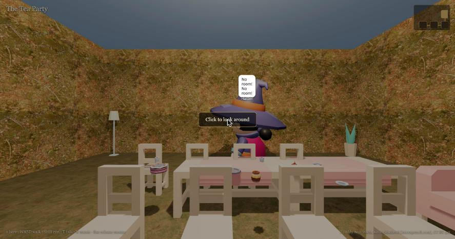
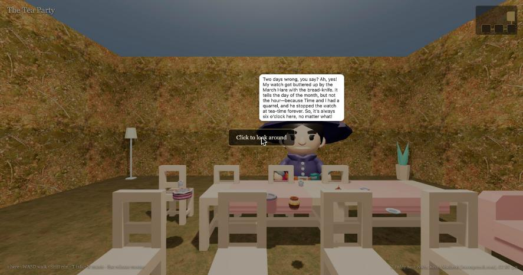

The last picture is the whole idea in one frame: the player wrote "Hatter, your watch is two days wrong", the character turned round, and the agent answered from chapter 7.

On the chat side the move between rooms is half done: with the agent set to "unlisted" the server token can invite it into the next room, but `leave-chat` answers 403, so the agent stays a member of every room it has visited (ETHORA-GAPS #14). Since it only answers when named, that is tolerable for now.

## 18 Oct 2026: the generator, the provisioner and the first numbers

**Measurement first, because it is small.** The world service now appends one JSON line per event to a local file: enter (with an anonymous id the browser keeps), join (room, door, who was already there), leave, message (only whether it named a character; never the text). `pnpm metrics` turns that into the numbers the plan asks for: sessions and visitors per day, rooms per session, messages to characters against messages to humans, sessions that shared a room with another human, and day-7 return. The same report is served at `/api/metrics` behind a token for the deployed server. A walk through four rooms and two chat lines produced the first report: rooms per session 4, messages 2, one of them to the Hatter.

**The generator.** `pnpm generate -- --gutenberg 11` fetches the book from Project Gutenberg, strips the wrapper, splits chapters (the table of contents is recognised and dropped because its "chapters" are a few lines long), and hands the model the whole text with the lists of what it may use: textures, panoramas, music, avatars from a new asset manifest, props from the catalog. The model answers with a draft, not a world: rooms on an integer grid with links between adjacent cells, asset ids, chapter numbers, personas, greeting scripts. A converter turns that into world.json and fixes what models get wrong: diagonal links are dropped, unreachable rooms are linked to a reachable neighbour, props that are not in the catalog disappear, props standing in a doorway are removed, tabletop and flat items get their flags, cooldowns are clamped, every long dash becomes a hyphen. Then the normal validator runs and, if it complains, the model is asked once for a repair with the list of problems.

Two model backends: the Anthropic API when a key is present, otherwise the Claude Code CLI already on the machine (`claude -p` with tools off and a JSON schema), which is how the first run went. Alice in Wonderland, six rooms, three characters: one attempt, no warnings, $2.93, four minutes. The model chose the Rabbit-Hole, the Long Hall (three exits), the Mushroom Wood with the Caterpillar, the Mad Tea-Party as a panorama room, the Queen's Croquet-Ground and the Court of Justice, wrote personas that quote the book, gave the Queen a schedule that takes her to the court every two hours, and put "Off with their heads!" on the three-quarter hour.

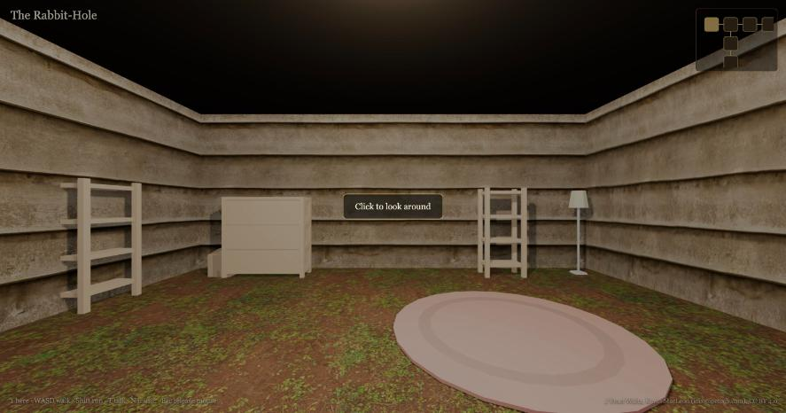
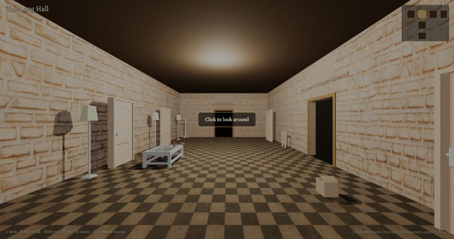

**The provisioner.** `pnpm provision -- --world alice` does over the hosted Ethora MCP what was done by hand on day one: app, one chat room per location, one agent per character with the persona plus the room's setting and the house rules, the chapter files uploaded into the agent's own knowledge base, visibility set to unlisted (so the world service can move the agent later), invite into the home room. Every step lands in the gitignored `ethora.json` as soon as it succeeds, so a rerun continues where it stopped and a finished world reports "nothing to do". It authenticates with an Ethora user API key sent as a bearer header, which is how the hosted MCP serves headless clients. The claude.ai connector used in these sessions hides the tool that mints such keys (ETHORA-GAPS #15), so the real run against Ethora waits for a key from the owner; until then the provisioner is tested against a mock MCP server that answers with the shapes the real tools returned on day one, including a wrong-key run and the idempotent rerun.

Also learned: the Claude Code CLI refuses to start inside another Claude Code session unless the `CLAUDECODE` variable is removed from the child's environment; and pnpm's `pnpm --filter pkg script` shorthand does not resolve for a freshly added package, so the root scripts say `run` explicitly.

## 18 Oct 2026, afternoon: sound

The owner asked for steps, world sounds and voices. Three layers, all client side, nothing new on the server.

**Footsteps.** Every avatar already reports idle, walk or run, so a small stepper plays a sample at a walking or running cadence whenever the state says moving, with a little pitch jitter so five samples do not sound like a metronome. The room's floor picks the set: `surface` in the world file, or a guess from the floor texture name (planks are wood, tiles are stone, grass is grass). Samples are Kenney's CC0 Impact Sounds. Your own steps play in your head, quietly; other players' and characters' steps go through a panner at their position, with the audio listener glued to the camera each frame, so the Hatter walking round the table is heard on the right side.

**Doors, clicks, ambience.** A door creak on each room change, open and close clicks on the chat panel, a soft drop when someone else speaks. Ambience without files: four small Web Audio generators, drips with a cave echo for the well, a ticking clock for the hall and the tea party (it is always six o'clock), birds and wind for the garden. The world file lists presets per room, so a generated world gets them from the model like the music.

**Voices.** Characters read their lines through the browser's speech synthesis, off by default, V to switch on. Each character gets a fixed voice, pitch and pace from a hash of its name, so the Hatter stays the Hatter. Scripted lines and agent replies are spoken; human messages never are. The sequence that convinced me: walked into the tea party, the greeting came up as a bubble and was spoken; asked the Hatter about the date, the agent's reply was spoken too. Cloud voices can replace this later behind the same switch if the usage report shows people keep it on.

Verified in Chrome with the dev counters: wood steps in the well, stone in the hall, grass outside, the door on each change, chat open and close, two greeting lines and one reply spoken.

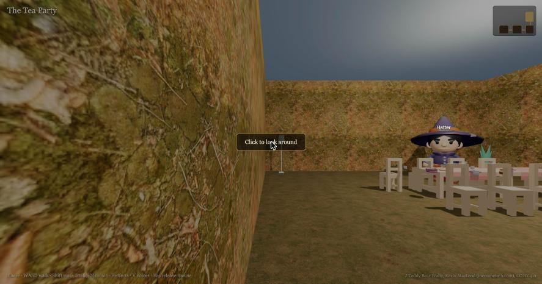

## 18 Oct 2026, evening: a daily budget

"When we expose this to the public they will not bankrupt us." Two meters. The first counts paid character replies: every message that names a character present in the room makes its agent answer, so the world service counts those per world and per visitor per day and persists the count. At the world limit the characters rest until the daily reset: every client gets the state over the Colyseus room, the HUD says so, the rooms get a narration line, and the chat panel's outgoing text gets a zero-width space inside each character's name (it reads the same to people, but the agent's mention matcher no longer fires). The per-visitor share works the same way for one person. The app's server token is not allowed to change an agent (403), so the real off switch, setting the agents to answer with probability zero, runs over the hosted MCP with a user API key when one is configured; without it the client-side gate is the only guard, which is enough against ordinary use and not against someone scripting the XMPP connection. Ethora's own plan limits sit in front of all this.

The second meter is the generator: runs and dollars per day in the same budget file. The CLI backend reports real cost, the API backend estimates it from tokens. It only guards the owner's own runs today, but a public "turn my book into a world" button would hit the same ledger.

Checked live with the limit set to two: the third question to the Hatter went out with a zero-width space inside "Hatter" and he stayed quiet; the notice appeared at the top of the screen; `/api/ai-budget` showed used 2, asleep true.

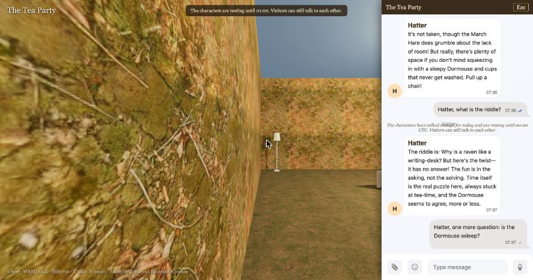

## 18 Oct 2026, night: being away, coming back

The owner asked what happens to someone who is inactive or disconnected. The honest answer was: a drop meant "has left" after fifteen seconds with no way back except a reload as a stranger, and an idle tab stayed "here" forever. Three changes.

**A minute to come back.** When a connection drops without a goodbye, the server keeps the seat for sixty seconds (the avatar waits, marked away) and the client tries to reconnect every few seconds; the same seat, no narration. If the window passes, the client rejoins at the same spot as a fresh arrival. Tested by closing the socket from the console: "Reconnected" came back in under a second, same session id.

**A reload is not a new visit.** The session token, the room and the last position now live in the tab; on reload the client asks the server to resume, gets fresh chat credentials for the same identity, and joins the same room at the same spot ("Alice is back" rather than "Alice has arrived"). The usage report counts no new session. Along the way the chat identity moved from one Ethora user per entry to one per visitor and name, so coming back as Alice is the same chat user and the app's user list stops growing with every visit. A "Leave" link in the bottom line forgets the visit.

**Away, then gone.** Five idle minutes mark the player away (others see "(away)", the room count skips them, the bottom line says so); twenty minutes and the client leaves the room with "has wandered off", shows a dark screen, and any key brings the player back to the same spot. Tested with the timers set to eight and twenty seconds.

One side effect found on the way: React's StrictMode runs effects twice in development, which has joined every room twice since day one, and with the reconnection window the first seat now lingered as a ghost for a minute. StrictMode is gone.

Also from the owner, the same evening: the chat panel is translucent now and you can keep walking while it is open. T puts the cursor in the message box, Esc takes it out again (keys walk, the panel stays for reading), a second Esc closes the panel.

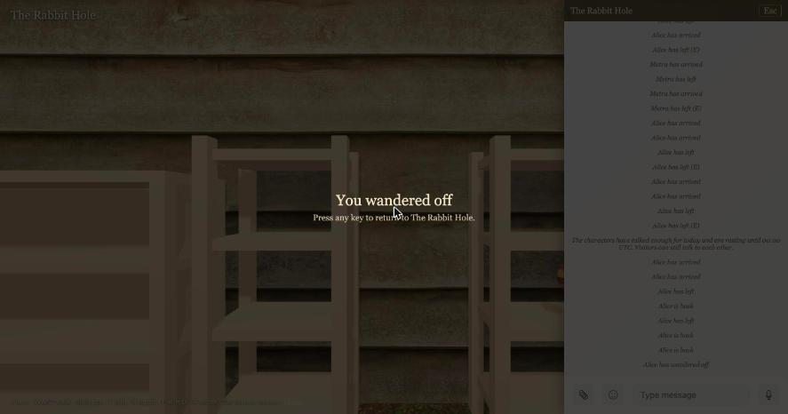

## 18 Oct 2026, late: The Tempest, and a jump

**Jump.** Space. The controller already knew how; what it needed was a longer jump phase so its floating spring did not pull the body back down after a hand's width. About 1.3 m now, enough to get onto the tea table.

**The second world.** `pnpm generate -- --gutenberg 23042 --slug tempest --rooms 7 --characters 4` with a note asking for an enacted play. Five acts became five knowledge chapters. The model laid out the island as seven places: the wreck on the shore, the yellow sands, Prospero's cell in the middle with four doors, Caliban's rock, the line-grove, the filthy-mantled pool, the grass-plot. Prospero, Ariel, Caliban and Miranda have hourly schedules that put the right pair in the right room a few minutes before each of seven scripted scenes, lines taken from the text: Prospero and Miranda on the twelve years since Milan at five past, Ariel and Caliban calling each other liars at the pool at thirteen past, "Our revels now are ended" on the grass-plot at seven minutes to. $3.55, one attempt, no warnings. The Yellow Sands and the wreck are Borghese gardens with a sand or plank floor, because the only panorama we have is a Roman garden; a shore HDRI is the next asset to fetch.

**Standing it up.** No Ethora API key yet, so the provisioner's plan was run by hand over the MCP in the same session, the way the docs say a Claude Code session can: app, seven rooms, four agents with the generated personas plus the house rules, visibility unlisted, each invited home. The knowledge went in differently: instead of uploading five files per agent through the conversation, one call per agent crawled the play from its Gutenberg URL, 170 KB each, done in seconds. The provisioner now does the same for any Gutenberg source. Prospero's first answer, to "whose island is this": "This island is mine by right, though long unheld ... I, by art and command of spirits, raised a tempest to bring my usurpers here."

**A finding on the way.** For a few minutes the world service ran the Tempest with the Alice app's secret, and Ethora accepted it: the guest user was created in the wrong app with the wrong secret. Both apps belong to the same owner, so the check is probably per tenant, but an App Secret should open one app only. Logged as gap 18, security. The service now refuses to use the shared secret when more than one world has Ethora ids; each world gets `ETHORA_CHAT_APP_SECRET_<SLUG>`.

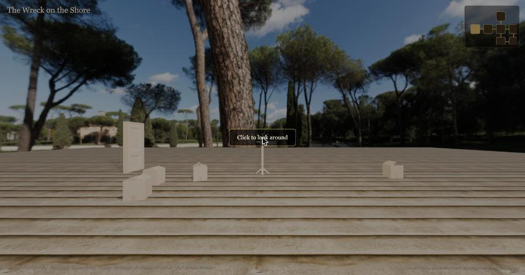
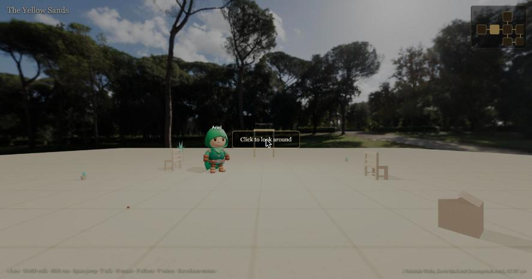
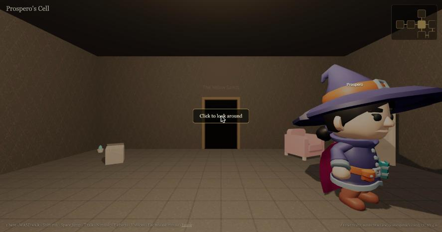

## 18 Oct 2026, later: a shore, and a front door

**Two panoramas.** Poly Haven has a cove with a rusting wreck in the surf (Aristea Wreck) and a long beach at sunset (Fish Hoek Beach), both CC0, 6 MB each at 2k. The wreck room and the yellow sands use them now; the grove, the pool and the grass-plot keep the garden. The manifest lists them, so the next generated world can pick a shore.

**The front door.** With two worlds live the join screen became a picker. The world service now keeps presence per world (who is in which room, away or not, when a human last did anything, messages all time and today, visits) and `GET /api/worlds` returns a card per world: title, author, a one-line summary the generator writes, the rooms with a count beside those that have people in them, the characters, "2 people here now", "14 messages, 6 today", last activity, and whether chat is on and the characters are awake. The cards refresh every fifteen seconds while you choose. A dashed card says how to make your own world from a book; the form that would run the generator behind the budget is the obvious next step.

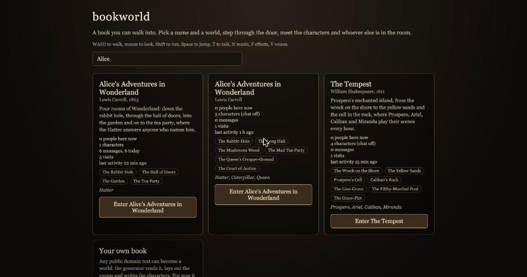
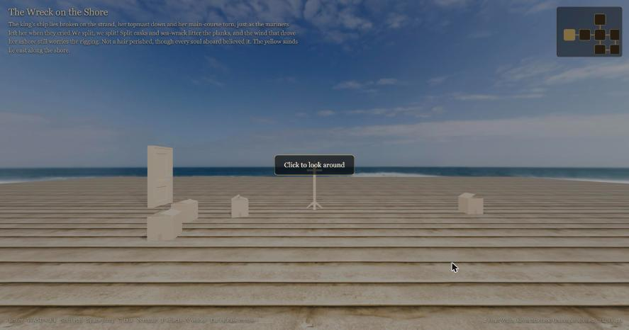

## 18 Oct 2026, evening: numbers for the home page, and a form

The owner wanted the counters outside the engine as well, for a project home page. So the world service now has a small public API (`docs/API.md`): `GET /api/stats` with people online, totals and the cards, `GET /api/worlds` with the cards alone, and `GET /api/badge.svg`, an image any page can embed with an img tag that reads "3 visitors now". All open to any origin and cacheable for a few seconds.

Then the form. The generator became a function the world service can call, and the dashed "Your own book" card on the join screen became a form: title, author, Project Gutenberg number, rooms, characters, notes. The server runs one job at a time with a queue of three, checks the generator's daily budget first, generates, provisions on Ethora when it has an API key, loads the new world into the running service, and the card appears. The job's log streams to the form while it works. What it cannot do is the last step: the App Secret still has to be copied from the dashboard by hand (gap 8), so a world made by a visitor has rooms and characters on Ethora but no chat until the owner pastes one line into `.env`. That is the one thing between this form and a public "turn your book into a world" button.

The first world made through the form, while writing this: "A Christmas Carol", Gutenberg #46, five rooms and three characters, $3.33, four minutes. Scrooge's counting-house, his chambers, Fezziwig's warehouse, the Cratchits' kitchen and the churchyard; Scrooge, Marley's Ghost and the Ghost of Christmas Present, who make their rounds on the hour: Marley into the counting-house at the top of the hour ("Expect the first Spirit when the bell tolls One!"), Present into the chambers at half past. The card appeared at the top of the list before the log had finished scrolling. It is in the repo as the third world.

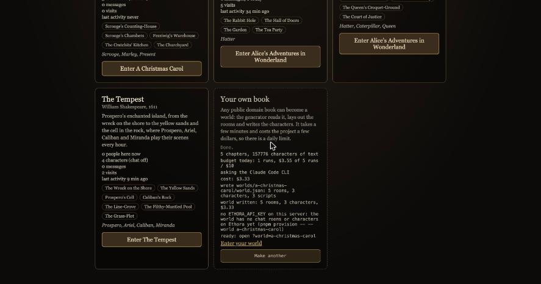

## 18 Oct 2026, later: the Tempest speaks, and a second player on the Wi-Fi

The owner sent the Tempest app's App Secret. One line in `.env`, a restart, and the island's chat came on: Ariel, asked on the Yellow Sands what became of the ship, answered with the harbour and the sleeping mariners, straight from the play. The visit was made from the machine's network address rather than localhost, which is how a second person on the same Wi-Fi gets in. Until now the client had the world service pinned to localhost, which works only on the machine running it; it now defaults to whichever host served the page, port 2567, so `http://192.168.x.x:5173` works for a phone or a laptop across the room with nothing to configure. The README says how.

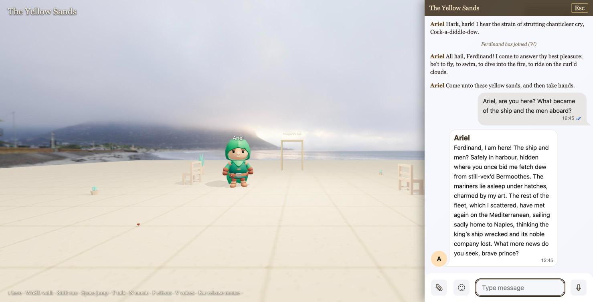

## 18 Oct 2026, night: feedback from the first family test

Two boys ran around the island for half an hour on the Wi-Fi, and the owner came back with a list. Each item, what was behind it and what changed:

**Your old avatar stays after a reload.** A reload made a new seat while the old seat waited a minute for its connection to come back; "Ferdinand is back" and, a minute later, "Ferdinand has left" appeared in the chat with every reload. Worse, when that old seat expired the service revoked the person's chat membership in the room, which cut the live seat's chat too. That is almost certainly what "chat wasn't working in the Tempest" was: a reload or two in the Tempest, and a minute later the messages stopped. Now a reload reconnects into the same seat (the client keeps the seat's reconnection token for the tab), and if that window has closed the service drops any older seat of the same player when the new one arrives, quietly: no "has left", no revoke while the person is still in the room.

**Walking through people.** Other players and the characters now have a body: a kinematic capsule that follows the drawn avatar. You bump into Caliban and slide round him; walking straight at him stops at 0.6 m.

**No way out.** The "Leave" link in the bottom line was too small to find with the mouse captured. There is a Menu button top right and the M key: where you are and who is here, back to the world, leave to the list of worlds, the three sound toggles, and the controls.

**Chat background not see-through.** The panel itself was translucent, but the chat component paints an opaque gradient behind the message list. Removed; the room shows through now, the bubbles stay solid.

**The App Secret.** The owner asked why the secret still has to be pasted by hand for every new world. The Ethora docs make it policy: the secret is "never returned over MCP", dashboard only. Gap 8 now carries the exact wording and a proposal (return it once at app creation, or let the credentials reveal tool include it for the owner's own apps).

Also found tonight: the Ethora backend SDK logs every request payload at debug level, guest passwords and server tokens included, unless NODE_ENV is production. The world service sets that now; gap 19.

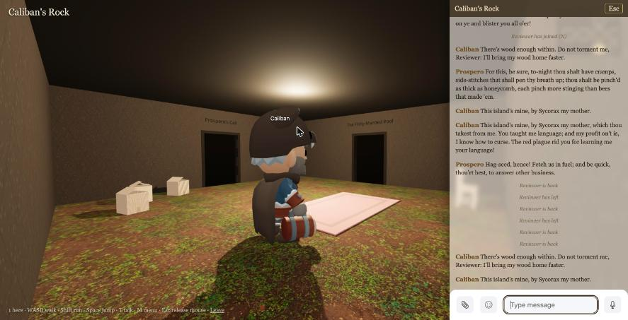

## 19 Oct 2026: live for the team at bookworld.ethora.com

The owner's call this morning: no new droplet. The world lives on the shared DigitalOcean box that already hosts the Ethora satellite sites, as a fifth small Node service behind the box's Caddy, on a subdomain proxied through Cloudflare. The brief for that is `docs/DEPLOY.md`; the pieces that follow it are in `deploy/`: a systemd unit with a 350 MB cap, the Caddy block (static client from disk, everything else to the service on a localhost port, noindex for the test period), an idempotent install script for the box and a push script for the Mac that builds the client for the public URL and copies the checkout over one SSH connection, because the box rate-limits port 22.

Three things had to change in the project to run there. The server had no build output (its workspace packages export TypeScript sources), so it runs its sources through tsx in production and tsx is a runtime dependency. The service binds to a host when told to, so it listens on 127.0.0.1 behind Caddy and still on every interface at home for LAN play. And scheduled character lines, cron scenes and the narration of character moves now post only to rooms with a player in them: the Tempest had been running seven scenes an hour for an empty island, and a line that names another character can draw a paid reply from that agent with nobody reading it. Ethora counted 3.7 million tokens on 18 Oct from local testing alone, and that is a likely part of it. The daily caps are in the production env file.

The deploy itself took three attempts, all on the Mac side: the system bash is 3.2 and sourcing from a process substitution sets nothing there; npm put pnpm under the Node prefix where sudo's reset PATH could not find it. Then: user, dependencies in seven seconds, unit, health check, Caddy block, certificate. From the outside: TLS, the noindex header, all three worlds, chat on for Alice and the Tempest, a visitor counted in the Rabbit Hole, a message delivered. The owner ran the push script, since this session's permission rules keep it off production hosts.

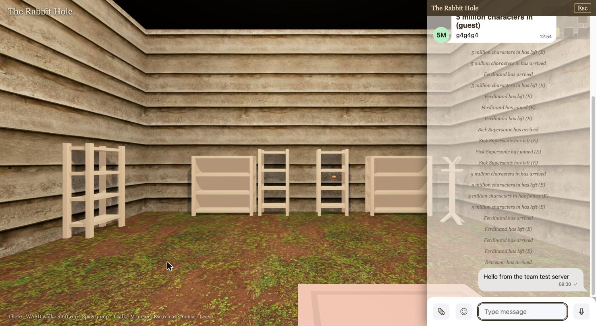

## 21 Oct 2026: two more worlds, Transylvania and Camelot

The owner asked for Dracula's Transylvania and the world of King Arthur. Both came out of the generator in one evening from their Project Gutenberg texts: Stoker's novel (number 345) and Howard Pyle's "The Story of King Arthur and His Knights" of 1903 (number 60184), chosen over Malory because Pyle's prose is lively, modern enough to read, and has Merlin, Excalibur, Guinevere and the Round Table all in one book.

Dracula stays in the Carpathians, as asked: the Golden Krone at Bistritz, the Borgo Pass by night, the courtyard, the library where the Count talks with his guest, Harker's bedroom with the locked doors, the ruined chapel with the boxes of earth, the tower window. Dracula hosts in smart mode; Jonathan, Mina and Van Helsing answer when named. King Arthur has the churchyard with the sword in the anvil, the tournament field, the Forest of Adventure, the Lake of Enchantment, Guinevere's garden at Cameliard, the great hall with the Round Table and Merlin's tower chamber, with Merlin as the host. Each world has two cron scenes an hour and schedule moves to bring the pairs together, as in the Tempest.

Provisioning was by hand over the hosted MCP again, in the provisioner's order and with its exact payloads (the agent prompt function was imported straight from the provisioner so the house rules match): two apps, fourteen rooms, eight agents, eight crawls of the Gutenberg text with the weekly re-crawl switched off, visibility unlisted, invitations into the home rooms. The smoke test: Dracula answered "Enter freely and of your own will!" in his library, and Merlin sent the visitor to the churchyard, the field and the garden. Both replies carried a long dash despite the rule in the prompt; the model does what it does.

What is missing is the one thing the API will not give (gap 8): the two App Secrets from the dashboard. Until they are in the env files the new worlds run with chat off, and the characters stand in their rooms without a voice.

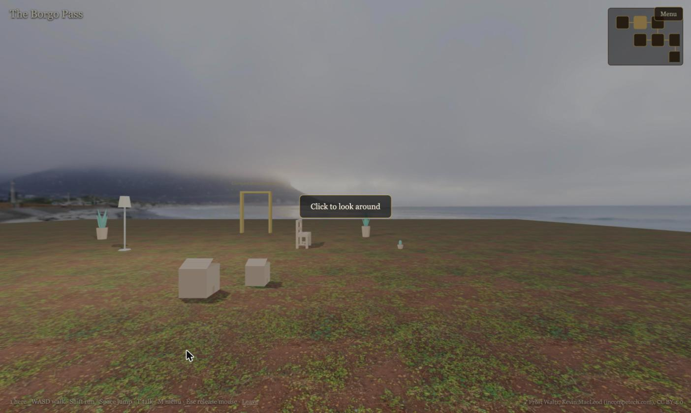

## 22 Oct 2026: the two new worlds get their voice

The owner pasted the App Secrets of the Dracula and King Arthur apps from the dashboard, and they are the same string. A fingerprint check against the local env files showed the Alice and Tempest secrets are that string too: four apps, one "App Secret". So the value the dashboard labels per app is a per-owner key, which is the explanation for gap 18 (a token for app B signed with app A's secret was accepted). The owner takes it to the Ethora backend team; here it changes nothing, each world keeps its own variable and a different value will drop in when Ethora splits them.

With the lines in `.env` and `.env.production` the local service reported chat on for both worlds, and the real test is a walk: into the Golden Krone as a visitor (guest created, arrival narrated, message delivered, nobody home since Jonathan lives upstairs in the castle), east through the door into the Borgo Pass, a question to Mina, and her answer in character about the carriage that has not come. Then the churchyard in London Town, where Arthur answered a question about the sword in the anvil in his courtly thou-and-thee. Both replies without a long dash this time.

One thing to watch: Arthur also answered his own scripted greeting. The world service posts scripted lines from the app account as "**Arthur:** ..." and the agent in mentioned mode read its own name in that line as a mention and replied, addressing the app by its name. Mina did not do the same with her lines in the Borgo Pass, so the check is not deterministic. That is a paid reply per arrival when it happens; gap 20 has the detail and the options.

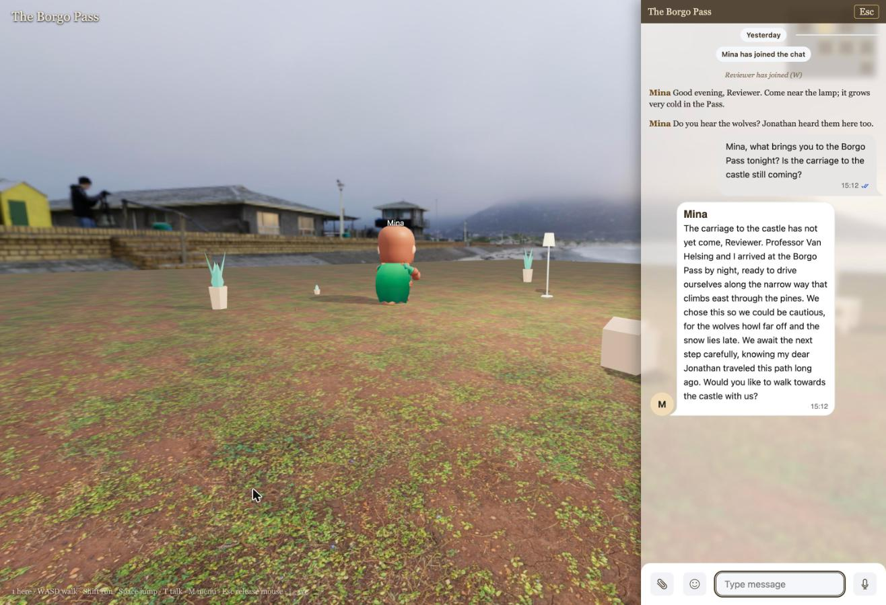

## 24 Oct 2026: instruments, and a jam with Ariel

The owner's idea for the weekend: things to pick up, starting with instruments, and music the characters can hear. The world file gets an `items` list (guitar, bass guitar, drums, piano, each in a room); the world service keeps where every item is and who carries it, so an instrument walks through doors with its player and stays on the floor where a dropped connection left them. E picks up and puts down. While you carry one, a chord bar sits at the bottom of the screen: keys 1 to 8 are C, Dm, Em, F, G, Am, E7 and G7, or the eight drum hits. Each press is synthesised in the browser (a plucked sawtooth through a closing filter for the guitar, partials with their own decays for the piano, a round sine with a growl for the bass, noise bursts and pitch drops for the kit) and sent to the room, where the others hear it from where you stand.

The part that makes it more than a toy is the chat. A run of chords becomes one narrator line a few seconds after the last press, "♪ Reviewer (guitar): C G Am F", so the characters read what was played. Their prompts now carry a paragraph that explains the notation and asks them, when invited, to answer with a line of their own in the same form. Every client in the room parses such lines from character messages and plays them. The first wording ("you may join the jam") got Ariel talking about chords in prose twice without writing the line; the second, which says the line is the only thing that makes a sound and gives each character its own example, worked at the first try: "♪ Ariel (piano): Am F C G. Come, come, let us foot it featly upon these yellow sands!" and the piano played over the sands. All thirteen agents have the new paragraph; the provisioner adds it to new worlds.

Two things seen on the way. Ariel answered that invitation from the wreck room, where she had never been invited (gap 21), which means a character can be called from anywhere in the app. And editing a shared source file while a visit is open makes Vite re-run the client's modules, which left a ghost seat in the sands with the guitar in its hands; a dev-only artefact, but one to remember when testing. Five worlds have instruments now: Ariel's guitar and Caliban's drum on the island, the Hatter's piano at the tea party, the innkeeper's guitar at Bistritz, the tournament drum at Camelot, Fezziwig's piano at the ball.

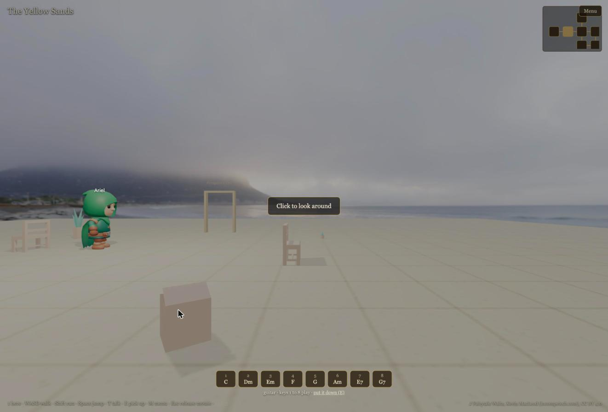

## 24 Oct 2026, later: the Songbook, a practice room with a trainer

The owner's idea for the evening: not a book this time but a lesson. Songs they like to play on the guitar, chords and words that will not stay in the head, and a character who drills them and remembers what keeps slipping. The engine already had the pieces: instruments to pick up, a chord bar, chord lines in the chat, characters who read the room. The new part is a practice room in the world file (`lessons`: a room, a trainer, an instrument) and a song folder next to it, ChordPro files, with a `pnpm song` command that turns a PDF or a pasted text with chords over the words into one.

The drill runs in the world service, not in the model. Rosie, the busker who teaches here, sings a line in the chat (a character line, so the client speaks it aloud if voices are on) and plays its chords for the room; the panel (L) asks for the next line's chords, on the guitar you carry, or its words, typed into a box. The room judges: a progression with the repeated strums collapsed, words by edit distance with eighty per cent as the pass mark, a hint for the first chord or the first two words at the cost of the line's promotion. A missed line comes back two rounds later and once more at the end; each line has a box per round, and a song is learned when every line sits in the top box in both. Progress lives on disk per visitor and comes back next time, so a second session starts with the lines that are not yet yours.

What the agent sees was the surprise. The service posts a `Lesson:` scoreboard into the room after every miss, and Rosie, asked how the visitor was doing, invented an assessment in prose, then, with a firmer prompt, said politely that the lesson had only just begun. Asked to quote the latest line beginning with "Lesson", she said there was none. So an agent does not see the app's own messages in its context at all, scripted lines and narration included, even though a mention in them can trigger it (gap 22). Two ways round it, both in: the client attaches the scoreboard in brackets to any question that names the trainer during a lesson, and the end-of-session note goes into Rosie's Memory, the agent's standing notes, which she reads on every reply. The Memory write from the service needs the user API key that is still missing (gap 15); done by hand over the MCP for the demo, Rosie recalled the session ("really slow on line 2, especially missing Neither have I wings") and, with the song files uploaded as her knowledge, gave the chords of line 2 exactly. Without them she had played line 2 as F C G Am, which is a fine progression and not the song.

Also in: the chord bar takes the song's chords during a lesson (keys 1 to 0 for up to ten), and a "listen (mic)" switch that folds the microphone's spectrum into the twelve pitch classes and matches it against the song's chords, so a real guitar can answer. The matcher passes its tests on synthetic spectra; it has not met a real guitar yet, and that is the first thing to try with one in hand.

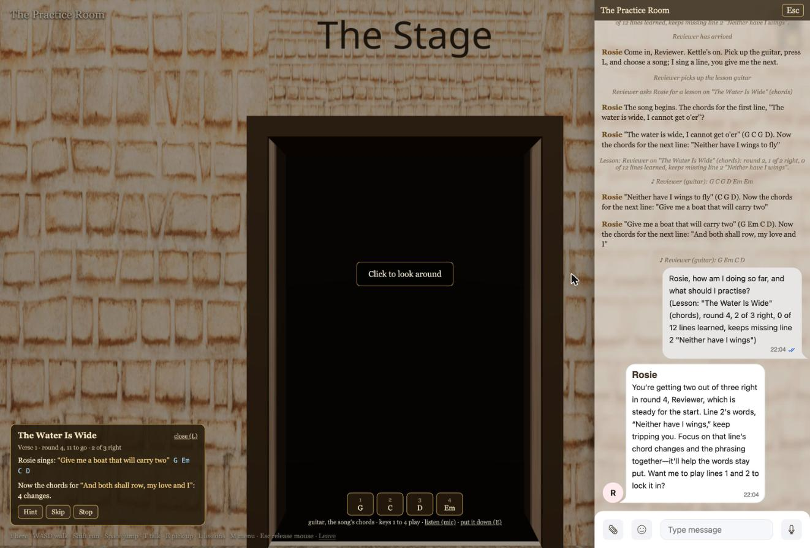

## 25 Oct 2026: singing to Rosie, a trainer who remembers your plan, and a debug log

Three things the owner asked for after the first evening with the Songbook. First, a log of everything the service sees, for debugging: `DEBUG_LOG=on` writes every event with its text to `server/data/debug/`, one JSON line each. The surprise was the chat: the service cannot read a room's history with its own token (404 CHAT_NOT_FOUND on the messages endpoint, gap 23), so while the log is on the clients mirror the messages they see and the server writes each once. The log immediately paid for itself: it showed Rosie answering her own scripted welcome four seconds after the service posted it, a paid reply per arrival (gap 20, now seen twice).

Second, real input. The chord matcher met something closer to a guitar than a line spectrum: a test synthesises plucked strings (Karplus-Strong) in the usual open voicings, windows and transforms them as the browser's analyser does, and asks the matcher to name each chord among its song's chords. The first run missed Am against Em and G7 against G; sharing the energy of a bin between the two semitones it sits between (the low strings fall between bins), compressing the amplitudes so one loud string does not drown the rest, and a finer analyser (16384 points) fixed it, and all twenty-two cases pass with the client's thresholds. The sevenths against their own triads remain the close calls, which is why only the song's chords are candidates. The words came next: a "sing (mic)" switch in a words round hands the microphone to the browser's own speech recognition in the song's language, the panel shows what it hears, and the room judges as the words settle, with the cue allowed in front of the line. Ukrainian and Russian songs work through the same path: a `{language: uk}` line in the song file picks the recogniser's language, the comparison reads letters of any alphabet (ё and е, ґ and г counted the same), and chord sheets that write B as H are read as such. Tested over the wire with simulated recogniser results; a real voice over a real guitar is the next thing to try, and the recogniser will do worse on singing than on speech.

Third, the trainer remembers. Each song has a star (your list), the panel has a goal in your own words, and the room keeps them with your progress and the last song and mode. Walk back in and Rosie greets you with your plan instead of the standard welcome ("Welcome back, Taras. Last time, today, we worked on "Oh My Darling, Clementine" (words); 0 of 8 lines are yours. Your goal: play Clementine through on the stage by Christmas. Pick up the guitar and press L; Continue takes us on from where we stopped."), and the panel opens with Continue. The goal rides along in the scoreboard attached to questions and in the Memory note. After a miss Rosie now plays the chords that were asked for, or sings the words, before the next round.

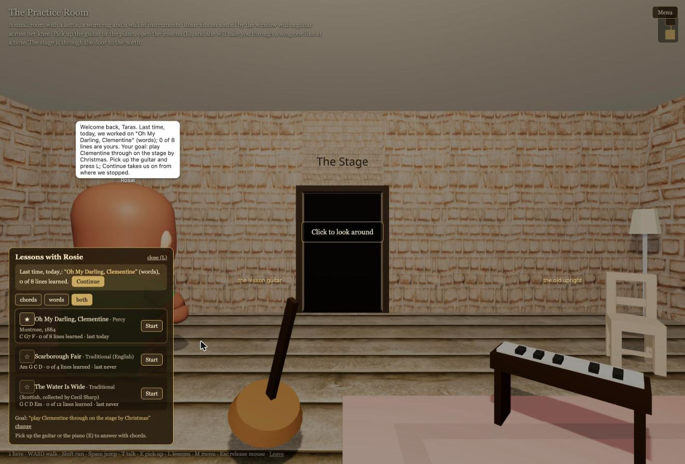

## 25 Oct 2026, later: the band

The owner's "build what possible" from the jam assessment. The first possible thing was accompaniment without a model: a bass and a drum kit lying in a room play along with whatever chords anyone strikes. The world service keeps a clock per room and sends each bar nine hundred milliseconds ahead with the server time of its first beat; the clients measure their offset from the server on join (a ping-pong, averaged) and schedule each hit in Web Audio against that time, from where the instrument lies in the room. The bass walks root, root, fifth, root under the last chord played; the kit keeps a plain rock beat with a crash on the first bar. The tempo is the song's (`{tempo:}` in the file, set when a lesson starts) or the - and + on the chord bar. In the browser the first bar's hits were scheduled 0.9 to 3.0 seconds out, the bass switched to G G D G one bar after the G was struck, and the clock offset on the same machine measured half a millisecond. Picking up the kit takes the drummer away; putting it down brings it back on the next bar.

The second thing: "another way?" on a chords verdict asks Rosie, in the visitor's own name, for a variation on the line, and her reply comes back as a music line the room plays. That one does use the model, a section late by design: it is a suggestion for the next time round, not an accompanist.

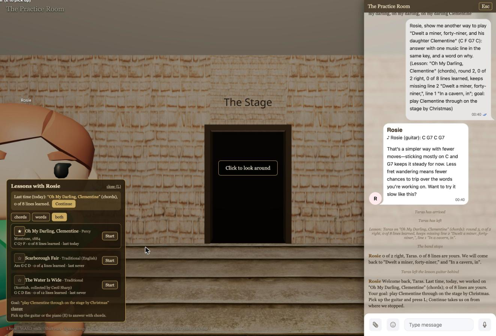

## 25 Oct 2026, night: voices of their own, and Rosie sings

"Go ahead with your recommendations": the speech half first, then singing for one song in one voice. The speech half is a voice service in the world service: a backend named in `.env` renders a character's line to an mp3 once (a local command, OpenAI's speech API, or ElevenLabs), the file is cached by world, character and text, and the clients fetch it when the line arrives in the chat and play it from where the character stands, falling back to the browser's voice if anything fails. The character's voice lives in the world file: a description, a sample for a cloning renderer, ids per backend. On this Mac the backend is the system's own `say` with Moira, an Irish voice, for Rosie; the first render of a line took seven tenths of a second, the cached one a millisecond, and in the browser both of Rosie's lines came from the server. The cloning renderer (`voice/render.py`, Chatterbox) is written and not yet run: this machine's Python is too new for PyTorch, so it waits for a GPU box or an older interpreter.

Singing turned out to be more tractable than feared, by refusing to make a model sing. A song file gets a `{melody:}` line above a lyric line, one note group per word; the renderer speaks each word through the same voice backend, takes it apart with the WORLD vocoder, stretches the vowel to the notes' length while the consonants keep theirs, sets the pitch to the notes with a short glide and a light vibrato, puts it back together and lands each word on its beat. The first line of Clementine, sung by Moira at 96 bpm, measured within eight cents of every target note (one short syllable was off by twenty). It sounds like a vocoder on the long notes and like Rosie on the short ones, which is the honest state of the art without a singing model, and it is in tune and on time. The lesson uses it: when a cue line has a melody, the client plays the sung file from Rosie and keeps the chat line's voice quiet; the service renders every melody line of a song in the background when a lesson starts. The melody lines for Clementine are my sketch of the tune and want a guitar and an ear.

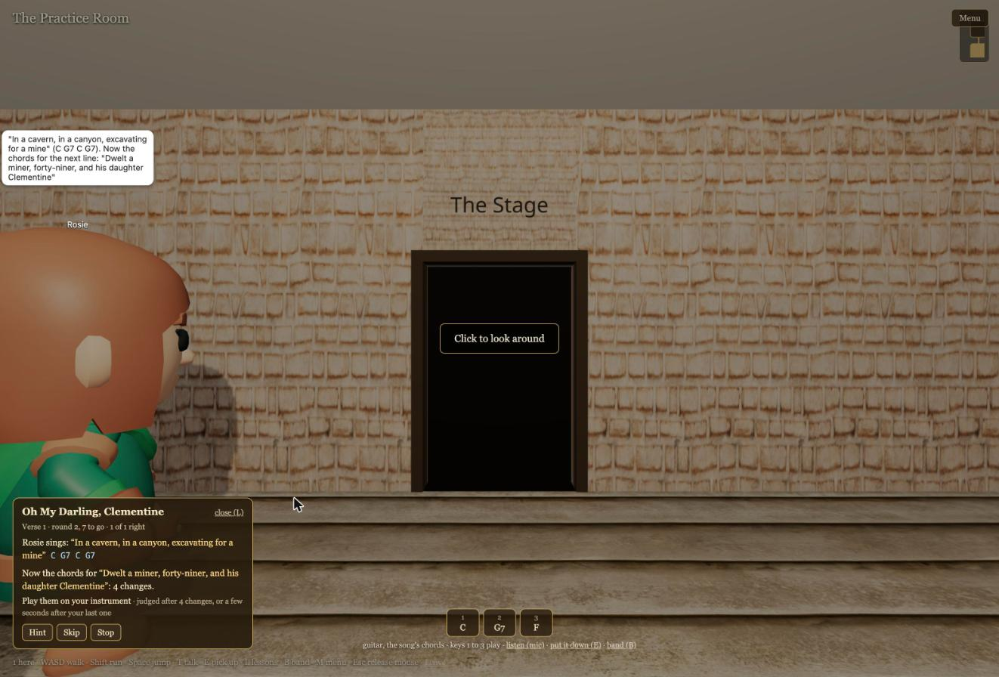

## 25 Oct 2026, early morning: Piper, a voice that runs on the droplet

"What is required for local say on the droplet? A GPU?" No. The speech half only needs a text-to-speech program that runs on a CPU, and Piper is that: small neural voices (60 to 120 MB each) for English, Ukrainian, Russian and some forty more languages, free and offline. `voice/piper-say.py` wraps it in the shape the command backend expects, `VOICE_IDS` lets the world file carry one voice id per renderer (`piper`, `say`, `openai`, `elevenlabs` side by side), and Rosie now speaks with `en_GB-jenny_dioco-medium`, an Irish English voice, which suits a busker from Galway better than the Mac's Moira did. On this Mac a four-second line renders in 0.9 s and is then served from the cache in a millisecond; the Ukrainian voice took the same. The singing renderer speaks each word through the same wrapper: Clementine's second line took seven seconds to render and measured within about ten cents of every note of the sketch (the picture), which is the same result as with the Mac's voice, so the pipeline does not care whose voice it bends.

The droplet has one core, 2 GB and a broken apt, so `deploy/install-voice.sh` gets everything without apt: `uv` into the service user's home, a Python 3.12 venv with Piper, pyworld and a bundled ffmpeg, the voices named in the world files downloaded once. The renders run as children of the service, one at a time and at low priority, so the unit's memory budget goes from 350M to 650M (the service, plus Piper's 190 MB, plus the singing renderer's 100 MB); `docs/DEPLOY.md` records the reason. A spoken line there should take two to three seconds the first time, a sung line about half a minute, rendered in the background when a lesson starts. Nothing deployed yet: the `.env.production` lines are in `docs/VOICES.md`, "On the droplet", for the owner to add before the next push.

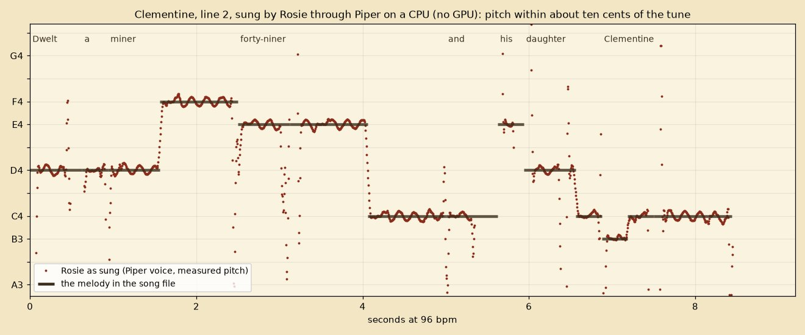
